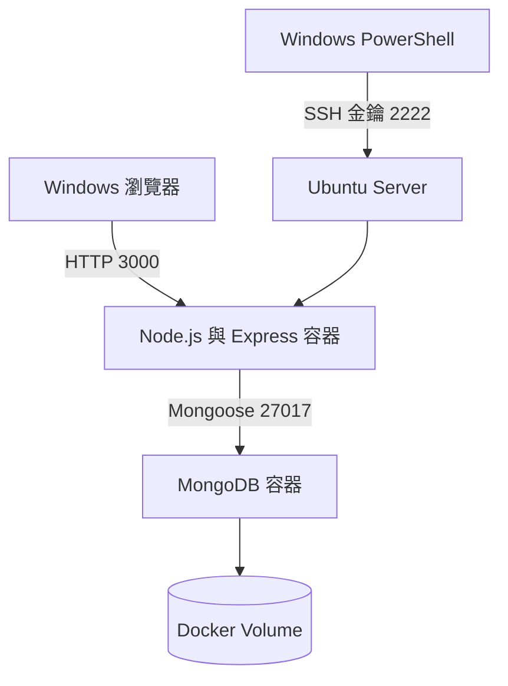

# 個人資料管理系統

本專案是在 Ubuntu Server 上，以 Docker Compose 部署的個人資料管理網站。訪客可以瀏覽公開資料，管理員登入後可以修改資料，內容儲存在 MongoDB。

## 功能

- 顯示姓名、學號、科系、電子郵件與自我介紹
- 管理員登入及登出
- 登入後編輯個人資料
- Session 登入狀態管理
- MongoDB 資料持久化
- Docker Compose 自動部署

## 使用技術

- Ubuntu Server 26.04 LTS
- Docker 與 Docker Compose
- Node.js 22
- Express
- MongoDB 8.2
- Mongoose
- HTML、CSS、JavaScript
- UFW
- SSH 金鑰驗證

## 系統架構



## 專案結構

```text
profile-system/
├── backend/
│   ├── Dockerfile
│   ├── package.json
│   └── server.js
├── public/
│   ├── index.html
│   ├── login.html
│   ├── profile.js
│   ├── admin.js
│   └── style.css
├── compose.yaml
├── .env
├── .gitignore
└── README.md
```

## 啟動方式

1. 建立 `.env` 並設定必要的環境變數。
2. 建立並啟動服務：

```bash
docker compose up -d --build
```

3. 檢查容器狀態：

```bash
docker compose ps
```

4. 開啟網站：

```text
http://127.0.0.1:3000
```

## 安全設定

- SSH 僅允許公開金鑰驗證
- 禁止 SSH 密碼登入及 root 登入
- UFW 預設拒絕傳入連線
- `.env` 不會提交至 Git
- 管理員密碼使用雜湊方式儲存
- MongoDB 未直接對外開放連接埠
- Express 使用 Helmet、Session 與登入速率限制

## 停止服務

```bash
docker compose down
```

## 作者

童兆瑜
